<a href="https://www.euriepaulino.me"><picture><source media="(max-width: 600px)" srcset="./assets/hero-narrow.svg" /></picture></a>

<div align="center">
  
</div>

<p align="center">
  <a href="#prologue">Prol.</a> ·
  <a href="#know-thyself">I</a> ·
  <a href="#the-fall">II</a> ·
  <a href="#the-plates">III</a> ·
  <a href="#the-commission">IV</a> ·
  <a href="#the-reliquary">V</a> ·
  <a href="#the-ledger">VI</a> ·
  <a href="#the-creed">VII</a> ·
  <a href="#lets-build">Epil.</a>
</p>

<p align="center">
  <a href="https://www.euriepaulino.me"></a>
  <a href="mailto:euriepaulino@gmail.com"></a>
  <a href="https://www.linkedin.com/in/eurie-paulino-6aa38438a"></a>
  <a href="https://x.com/EuriePaulino"></a>
  <a href="https://www.facebook.com/share/1HV98ifpzs/"></a>
</p>

<a name="prologue"></a>

<a name="know-thyself"></a>
<picture><source media="(max-width: 600px)" srcset="./assets/ch-i-narrow.svg" />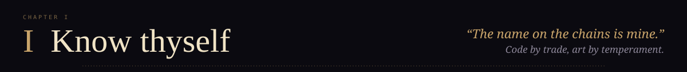</picture>

**Full-stack developer turned AI engineer.** I build websites, web shops, POS systems, Chrome extensions, plugins and bots. Given free rein, I build from imagination: [my portfolio](https://www.euriepaulino.me) is a chained seraph made of its own source code, and you scroll it like a book.

What you get from me: something that **works**, **looks good**, and is **safe**.

```console
$ whoami
eurie paulino  ·  software engineer / ai engineer

  based in ....... Philippines (UTC+8), working remote
  status ......... open for projects
  builds ......... websites · web shops · POS · extensions · plugins · bots · AI agents
  promise ........ it works. it looks good. it's safe.
  signature ...... compiled from scratch, so nothing leaves half-built

$ _
```

<a name="the-fall"></a>
<picture><source media="(max-width: 600px)" srcset="./assets/fall-narrow.svg" />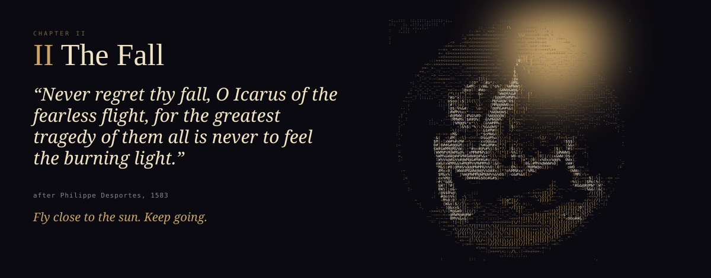</picture>

<a name="the-plates"></a>
<picture><source media="(max-width: 600px)" srcset="./assets/ch-iii-narrow.svg" />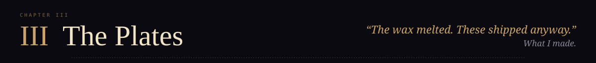</picture>

<table>
<tr>
<td width="50%" valign="top">

<a href="https://xnight.dev/">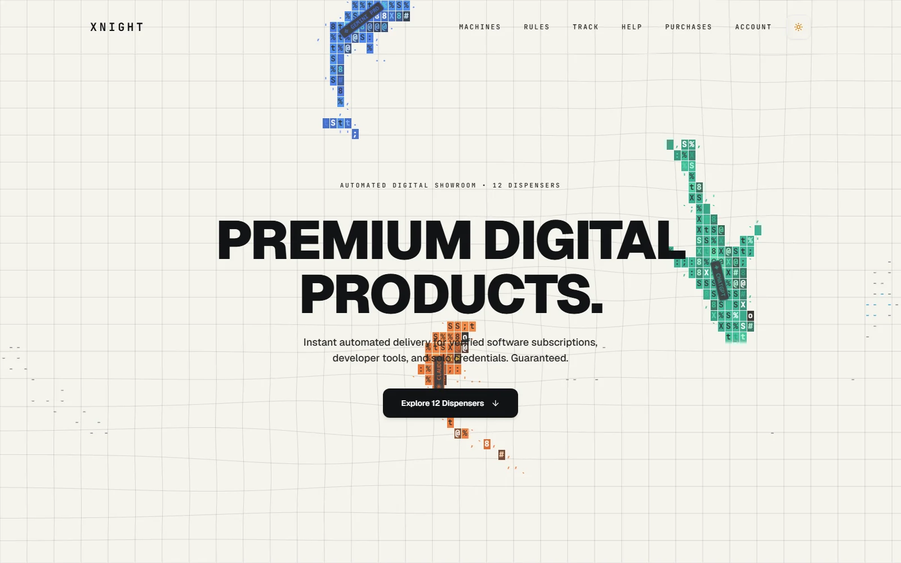</a>

### XNight
A digital product shop that sells, takes payment and delivers on its own, around the clock.

> Selling digital products by hand means late replies and lost orders.<br />
> **24/7** · sells and delivers itself

`Next.js` `Supabase` `TypeScript` · [**Visit site →**](https://xnight.dev/)

</td>
<td width="50%" valign="top">

<a href="https://github.com/Eurie92/fullstack-audit-skill">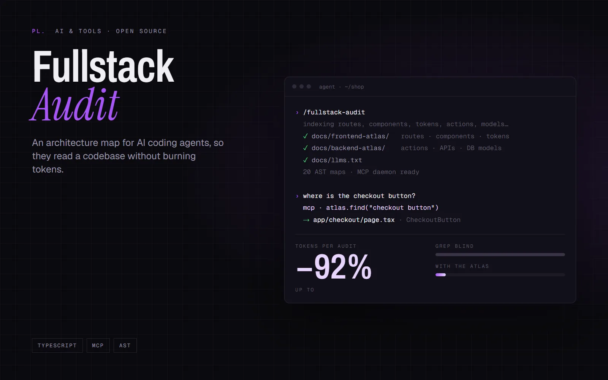</a>

### Fullstack Audit
An architecture map for AI coding agents, so they read a codebase without burning tokens. 20 AST maps plus an MCP companion.

> AI coding agents burn tokens re-reading a codebase.<br />
> **−92%** · tokens per audit (up to)

`TypeScript` `MCP` `AST` · [**View repo →**](https://github.com/Eurie92/fullstack-audit-skill)

</td>
</tr>
<tr>
<td width="50%" valign="top">

<a href="https://teleplug.bot-keep.xyz/">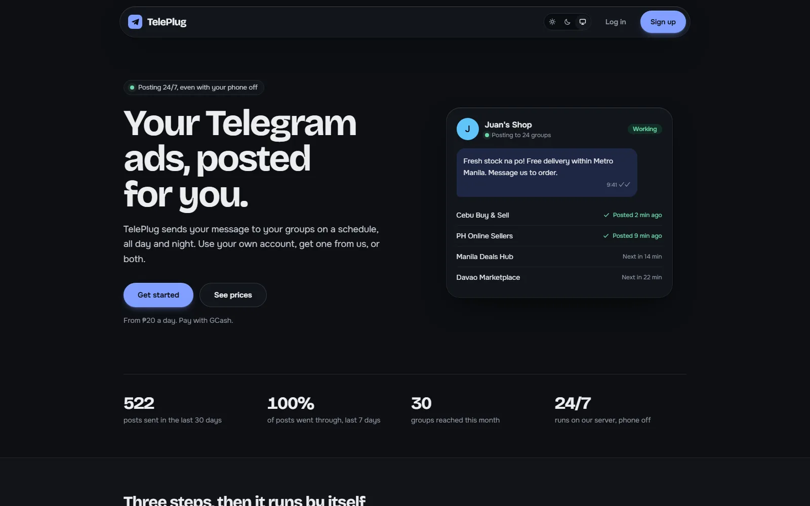</a>

### TelePlug
A Telegram broadcaster and forwarder with a live dashboard, scheduled posts and flood-wait handling.

> Posting to dozens of Telegram groups by hand eats the whole day.<br />
> **24/7** · posts on schedule, phone off

`Telegram` `React` `Node.js` · [**Visit site →**](https://teleplug.bot-keep.xyz/)

</td>
<td width="50%" valign="top">

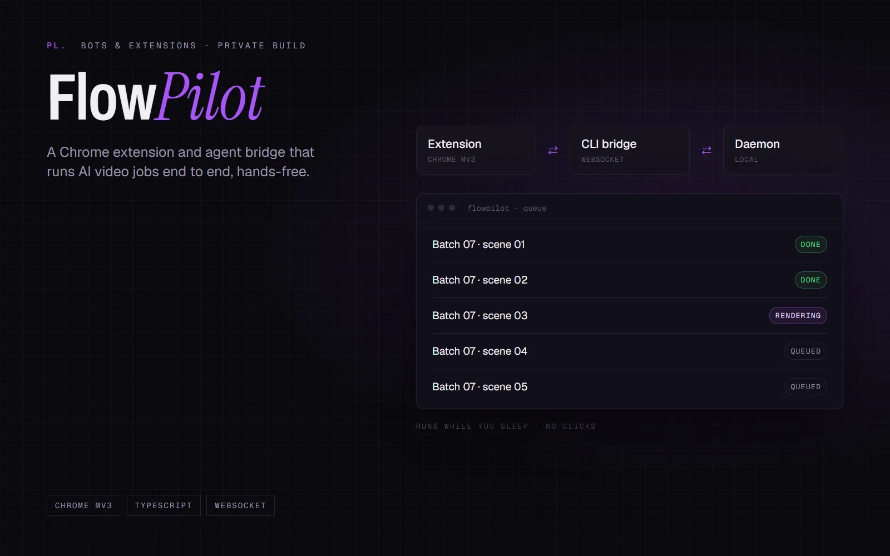

### FlowPilot <sub>`private build`</sub>
A Chrome extension and agent bridge that queues AI video jobs and runs them unattended. Extension, CLI bridge and local daemon.

> Batch jobs run while you sleep.

`Chrome MV3` `TypeScript` `WebSocket`

</td>
</tr>
</table>

<details>
<summary><b>More plates from the workshop</b> (5 more)</summary>
<br />

| Plate | What it does | Built with |
| :-- | :-- | :-- |
| **Flow Prompt Studio** <sub>private</sub> | Scores AI video prompts and learns from how the clips drift. | Python, AI video |
| **AHP Prompt Studio** <sub>private</sub> | A Gemini-powered workspace for writing, testing and keeping prompts. | Gemini, TypeScript |
| **AHP Dev Bridge** <sub>private</sub> | A VS Code and browser extension pair that lets AI agents act, behind safety gates. | VS Code, TypeScript, monorepo |
| **Weasolve** <sub>private</sub> | Tells you what to eat, based on the weather outside. | TypeScript, Python |
| **[V of Spades](https://github.com/Eurie92/V_of_Spades_SDG_Project)** | A C++ project built around the UN Sustainable Development Goals. | C++ |

</details>

<a name="the-commission"></a>
<picture><source media="(max-width: 600px)" srcset="./assets/ch-iv-narrow.svg" /></picture>

<table>
<tr>
<td width="33%" valign="top">

### Websites & web shops
*Sites and stores that load fast and sell.*

- Landing pages & portfolios
- Web apps
- Shops, checkout & payments
- POS systems

**Proof:** [XNight](https://xnight.dev/)

</td>
<td width="33%" valign="top">

### Interactive front-end
*Pages people scroll twice.*

- 3D & canvas
- Scroll stories
- Artistic portfolios
- Design systems

**Proof:** [euriepaulino.me](https://www.euriepaulino.me). You'd be scrolling it.

</td>
<td width="33%" valign="top">

### Automation & AI
*Bots and agents that take the busywork.*

- AI agents & MCP tools
- Bots & extensions
- Integrations
- Internal tools

**Proof:** [Fullstack Audit](https://github.com/Eurie92/fullstack-audit-skill), [TelePlug](https://teleplug.bot-keep.xyz/), FlowPilot

</td>
</tr>
</table>

```text
 HOW A COMMISSION RUNS

  ┌──────────┐      ┌──────────┐      ┌──────────┐      ┌───────────────────┐
  │ 01  CALL │ ───> │ 02  PLAN │ ───> │ 03 BUILD │ ───> │ 04 SHIP & SUPPORT │
  └──────────┘      └──────────┘      └──────────┘      └───────────────────┘
   tell me what      scope, price      you see the       launched, tested,
   you need, and     and timeline,     progress as it    and I stay
   who it's for      in writing        happens           on call

 ALSO IN THE WORKSHOP
  ├── chrome extensions ........ MV3, side panels, page automation
  ├── telegram & discord bots .. broadcasts, commands, dashboards
  ├── POS systems .............. sales, stock and receipts on one screen
  ├── AI agents & MCP tools .... agents that read, plan and act
  └── prompt tooling ........... studios, scorers, feedback loops
```

<a name="the-reliquary"></a>
<picture><source media="(max-width: 600px)" srcset="./assets/ch-v-narrow.svg" />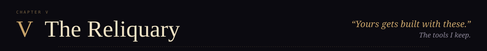</picture>

<p align="center">
  
</p>

```text
reliquary/
├── front-end/   TypeScript · React · Next.js · Vue.js · Three.js · Tailwind CSS
├── back-end/    Node.js · Supabase · PostgreSQL · Python · C++ · REST
└── ai-&-tools/  Claude · Gemini · ChatGPT · Antigravity · MCP · Vite · Git · Vercel
```

<a name="the-ledger"></a>
<picture><source media="(max-width: 600px)" srcset="./assets/ch-vi-narrow.svg" />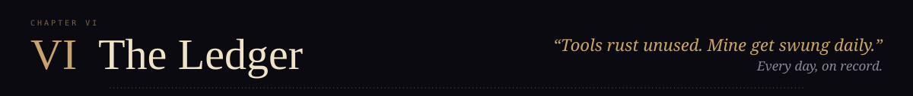</picture>


<sub>Redrawn every day by a GitHub Action straight from my contribution calendar. Private work counts too.</sub>

<a name="the-creed"></a>
<picture><source media="(max-width: 600px)" srcset="./assets/ch-vii-narrow.svg" /></picture>

<picture><source media="(max-width: 600px)" srcset="./assets/creed-narrow.svg" /></picture>

<a name="lets-build"></a>
<picture><source media="(max-width: 600px)" srcset="./assets/ch-epil-narrow.svg" />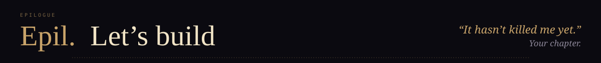</picture>

<div align="center">

### Chains are just links. Here are mine.

**[euriepaulino.me](https://www.euriepaulino.me)** · **[euriepaulino@gmail.com](mailto:euriepaulino@gmail.com)** · [LinkedIn](https://www.linkedin.com/in/eurie-paulino-6aa38438a) · [X](https://x.com/EuriePaulino) · [Facebook](https://www.facebook.com/share/1HV98ifpzs/)

Tell me what you need, and who it's for. Scope, price and timeline come back in writing.

```text
──────────────── ✦  ’til death, we do art.  ✦ ────────────────
```

<sub>Art: Hendrick Goltzius, <i>Icarus</i>, 1588 (The Met, CC0), redrawn in glyphs. The seraph is built from the same reference as the hero on <a href="https://www.euriepaulino.me">euriepaulino.me</a>.</sub>

</div>
