<a href="https://www.euriepaulino.me"><picture><source media="(max-width: 600px)" srcset="./assets/hero-narrow.svg" /></picture></a>

  

  <a href="#prologue">Prol.</a> ·
  <a href="#know-thyself">I</a> ·
  <a href="#the-fall">II</a> ·
  <a href="#the-plates">III</a> ·
  <a href="#the-commission">IV</a> ·
  <a href="#the-reliquary">V</a> ·
  <a href="#the-ledger">VI</a> ·
  <a href="#the-creed">VII</a> ·
  <a href="#lets-build">Epil.</a>

  
  
  
  
  

<picture><source media="(max-width: 600px)" srcset="./assets/ch-i-narrow.svg" /></picture>

<a href="https://www.euriepaulino.me"><picture><source media="(max-width: 600px)" srcset="./assets/whoami-narrow.svg" /></picture></a>

<picture><source media="(max-width: 600px)" srcset="./assets/fall-narrow.svg" /></picture>

<picture><source media="(max-width: 600px)" srcset="./assets/ch-iii-narrow.svg" /></picture>

  <a href="https://xnight.dev/">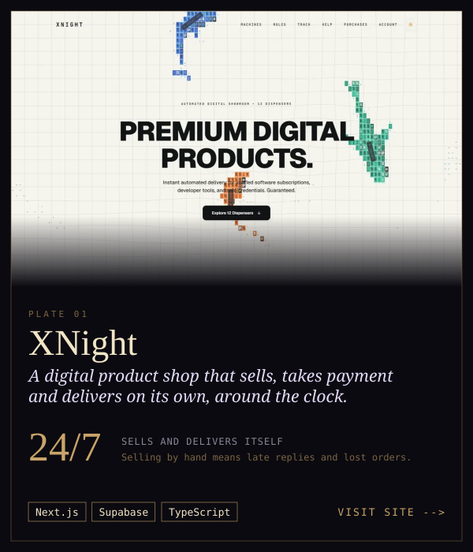</a>
  <a href="https://github.com/Eurie92/fullstack-audit-skill">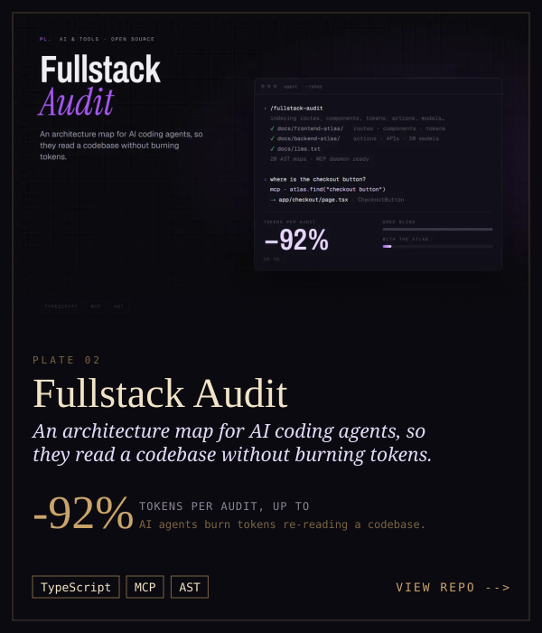</a>

  <a href="https://teleplug.bot-keep.xyz/">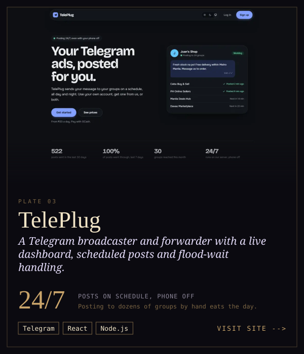</a>
  <a href="https://www.euriepaulino.me">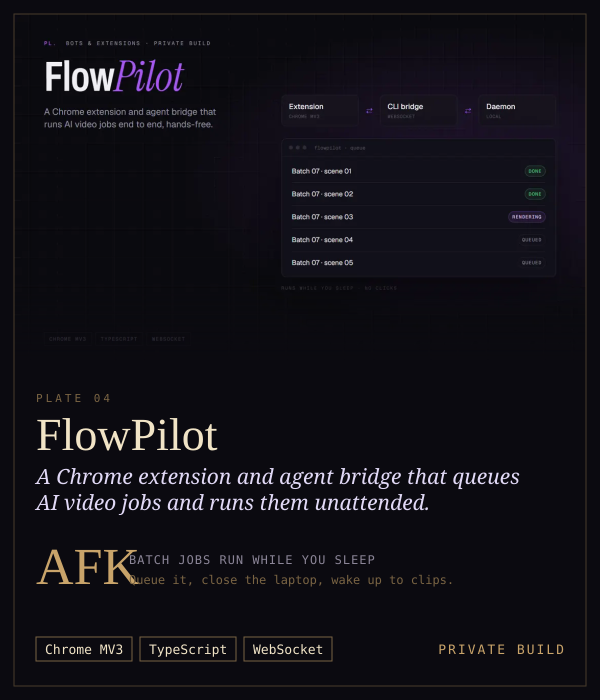</a>

<b>More plates from the workshop</b> (5 more)

 
<a href="https://github.com/Eurie92/V_of_Spades_SDG_Project">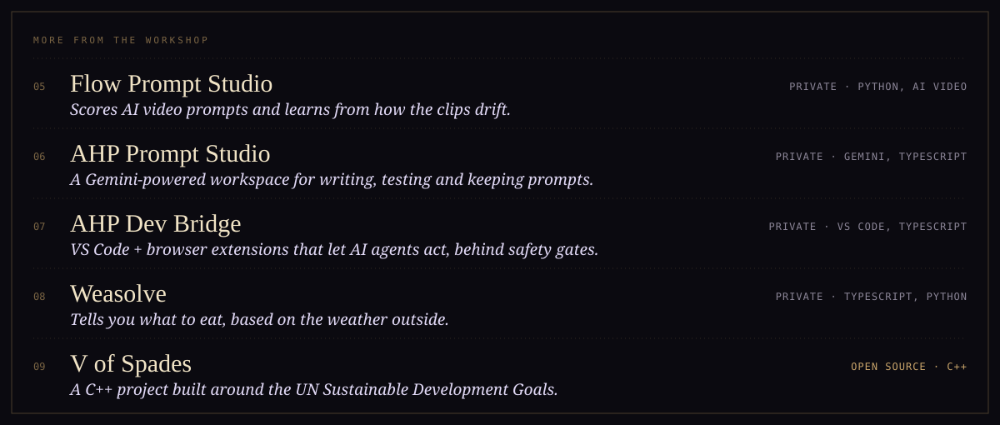</a>

<picture><source media="(max-width: 600px)" srcset="./assets/ch-iv-narrow.svg" />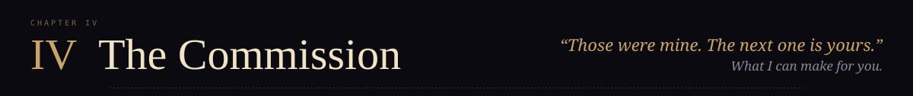</picture>

<a href="mailto:euriepaulino@gmail.com"><picture><source media="(max-width: 600px)" srcset="./assets/services-narrow.svg" />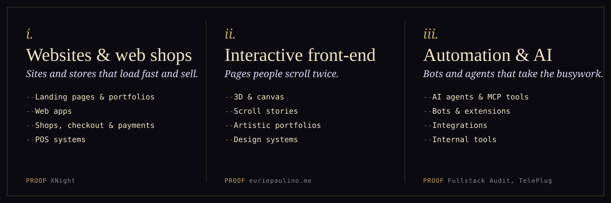</picture></a>

<picture><source media="(max-width: 600px)" srcset="./assets/process-narrow.svg" /></picture>

<picture><source media="(max-width: 600px)" srcset="./assets/ch-v-narrow.svg" /></picture>

  

<picture><source media="(max-width: 600px)" srcset="./assets/reliquary-narrow.svg" /></picture>

<picture><source media="(max-width: 600px)" srcset="./assets/ch-vi-narrow.svg" /></picture>


<picture><source media="(max-width: 600px)" srcset="./assets/ch-vii-narrow.svg" />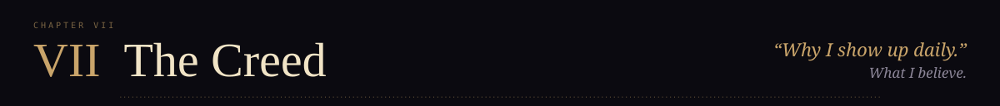</picture>

<picture><source media="(max-width: 600px)" srcset="./assets/creed-narrow.svg" />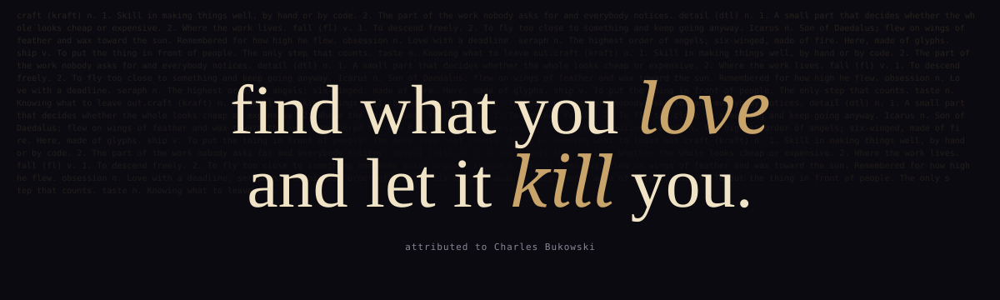</picture>

<picture><source media="(max-width: 600px)" srcset="./assets/ch-epil-narrow.svg" /></picture>

<a href="https://www.euriepaulino.me"><picture><source media="(max-width: 600px)" srcset="./assets/contact-narrow.svg" />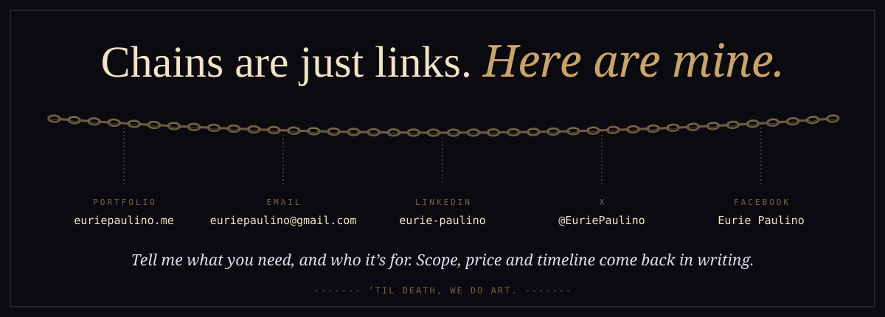</picture></a>

    

Art: Hendrick Goltzius, <i>Icarus</i>, 1588 (The Met, CC0), redrawn in glyphs.

